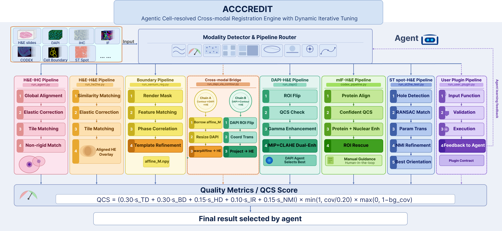

# ACCREDIT

**A Quality-Aware Agentic Engine for Cell-resolved Cross-modal Image Registration with Dynamic Iterative Tuning**

ACCREDIT is a quality-aware agentic registration framework for computational pathology that treats cross-modal registration as an adaptive decision process rather than a one-shot computation. It combines deterministic registration pipelines with a reference-free composite quality score (QCS) and an LLM-based rescue agent that autonomously diagnoses failure modes and selects recovery strategies. ACCREDIT supports six imaging modalities through a single unified entry point with content-based modality detection.

<p align="center">
  
</p>

## Supported Modalities

| Modality | Input | Method |
|----------|-------|--------|
| **Boundary** | Xenium nucleus parquet → HE | Contour-mask affine + block refinement |
| **DAPI** | DAPI/morphology fluorescence → HE | ROI flip search + phase correlation |
| **CODEX** | Multi-channel protein fluorescence → HE | QCS-based channel selection + ROI registration |
| **HE-IHC** | IHC adjacent section → HE | LightGlue + nonrigid refinement + Demons |
| **HE-HE** | Cross-platform HE → HE | Feature matching + Similarity + BSpline |
| **ST-HE** | Spatial transcriptomics → HE | Spot-pattern alignment |

## Quick Start

### Installation

```bash
# Clone the repository
git clone https://github.com/LeeZhou-bearway/ACCREDIT.git
cd ACCREDIT

# Create conda environment
conda create -n accredit python=3.10
conda activate accredit

# Install dependencies
pip install numpy opencv-python tifffile SimpleITK scikit-image openslide-python pillow
pip install torch torchvision   # for LightGlue (HE-IHC pipeline)
```

### Usage

ACCREDIT uses a single unified entry point. The system first analyzes image content to detect the modality, reports the result, and waits for user confirmation before proceeding.

```bash
# Auto-detect modality (recommended)
python run_unified_agent.py \
    --he data/HE_image.svs \
    --moving data/moving_image.svs \
    --output_dir output/

# Explicit modality
python run_unified_agent.py \
    --he data/HE_image.tif \
    --moving data/morphology.ome.tif \
    --mode dapi \
    --output_dir output/

# Boundary mode with parquet (Xenium)
python run_unified_agent.py \
    --he data/he_image.ome.tif \
    --parquet data/nucleus_boundaries.parquet \
    --output_dir output/
```

For more CLI examples (batch mode, skip confirmation, LLM rescue, sample directory), see [`examples/CLI_Usage.sh`](examples/CLI_Usage.sh).

### Interactive Modality Confirmation

When run in single-image mode, ACCREDIT reports its detection and asks for confirmation:

```
============================================================
ACCREDIT — Modality Detection Report
============================================================
  Fixed (HE):  data/HE_image.svs
  Moving:      data/sample_P40.svs

  Detected modality:  he-ihc
  Description:        HE-IHC (IHC adjacent section → HE, LightGlue + nonrigid + Demons)

  Image analysis:
    Imaging type:   brightfield
    Stain type:     IHC
============================================================

Available modalities: boundary, dapi, codex, he-ihc, he-he, st-he, senior

Proceed with this modality? [Y/n/modality name to override]:
```

You can confirm (`Y`), abort (`n`), or override by typing a modality name (e.g., `he-he`).

### Python API

```python
from run_unified_agent import run_unified

# Auto-detect modality
result = run_unified(
    he_path='data/HE.svs',
    moving_path='data/IHC_P40.svs',
    output_dir='output/',
)
print(f"QCS: {result.get('qcs')}")

# Explicit modality, non-interactive
result = run_unified(
    he_path='data/HE.tif',
    moving_path='data/morphology.ome.tif',
    output_dir='output/',
    mode='dapi',
    interactive=False,
)
```

## Tutorials

Step-by-step tutorials are available in the [`examples/`](examples/) directory:

| Tutorial | Description |
|----------|-------------|
| [CLI_Usage.sh](examples/CLI_Usage.sh) | All command-line usage examples (auto-detect, batch, rescue, etc.) |
| [Tutorial_DAPI_to_HE.py](examples/Tutorial_DAPI_to_HE.py) | DAPI fluorescence → HE registration (Python API) |
| [Tutorial_IHC_to_HE.py](examples/Tutorial_IHC_to_HE.py) | IHC adjacent section → HE (filename/content-based detection) |
| [Tutorial_Boundary_to_HE.py](examples/Tutorial_Boundary_to_HE.py) | Xenium cell boundary parquet → HE (replaces Xenium Explorer) |

## Modality Detection

ACCREDIT detects image modality through a multi-layer analysis pipeline:

1. **File format**: `.parquet` → boundary, `.png` with spot keywords → ST-HE
2. **Image content analysis** (performed at load time for all image formats):
   - **Brightfield vs fluorescence**: dark-background ratio distinguishes fluorescence from brightfield
   - **HE vs IHC**: HED color deconvolution compares DAB (brown) and Eosin (pink) channel intensities
   - **Channel count**: >5 channels in fluorescence → CODEX, otherwise → DAPI
3. **Filename hints**: common IHC markers (P40, Ki67, CD3, CD8, PD-L1, HER2, CK, etc.) provide fast-path detection

## Quality Composite Score (QCS)

ACCREDIT evaluates registration quality using a composite metric:

```
QCS = base_score × coverage_factor × background_penalty

base_score = 0.30 × tissue_dice
           + 0.30 × boundary_dice
           + 0.15 × (1 - hausdorff / HD_MAX)
           + 0.10 × inlier_ratio
           + 0.15 × NMI
```

| Component | Weight | Description |
|-----------|--------|-------------|
| Tissue Dice | 0.30 | Overlap of tissue masks |
| Boundary Dice | 0.30 | Overlap of boundary contours |
| Hausdorff Distance | 0.15 | Mean boundary distance (inverted) |
| Inlier Ratio | 0.10 | ORB feature match inlier ratio |
| NMI | 0.15 | Normalized Mutual Information |

Penalties: low tissue coverage and warped signal on background regions reduce the final score.

## Benchmark

Evaluated on 16 Xenium DAPI→HE samples at 4000px resolution (QCS):

| Method | Mean QCS | Samples |
|--------|----------|---------|
| **ACCREDIT** | **0.7673** | 16 |
| VALIS | 0.6687 | 16 |
| DeepHistReg | 0.5909 | 16 |
| SimpleITK | 0.3451 | 14 |
| VoltRon | 0.2521 | 15 |
| PALOM | 0.1632 | 14 |

Full per-sample and per-metric results are available in `benchmark/evaluation/`. See `benchmark/BENCHMARK_METHODS.md` for details on how competing methods were installed and evaluated.

## Project Structure

```
ACCREDIT/
├── run_unified_agent.py          # Unified entry point (modality detection → confirmation → registration)
│
├── agent/                        # LLM-powered rescue agent
│   ├── agent.py                  #   Main agent loop (Claude API)
│   ├── tools.py                  #   Registration tools exposed to LLM
│   ├── rescue_tools.py           #   Rescue-specific tool implementations
│   └── rescue_prompts.py         #   Modality-specific rescue prompts
│
├── registration/                 # Shared registration modules
│   ├── preprocess.py             #   Image loading, grayscale, H-channel extraction
│   ├── global_reg.py             #   Feature matching, similarity registration
│   ├── nonrigid_reg.py           #   BSpline, tile-feature non-rigid registration
│   ├── quality.py                #   Registration quality assessment
│   ├── warp.py                   #   Image warping utilities
│   └── xenium_reg.py             #   Xenium-specific registration
│
├── quality/                      # Quality metrics
│   └── quality_metrics.py        #   QCS computation (tissue dice, boundary dice, etc.)
│
├── pipelines/                    # Modality-specific pipelines
│   ├── boundary/                 #   Xenium parquet contours → HE
│   ├── dapi/                     #   DAPI fluorescence → HE
│   ├── codex/                    #   CODEX multi-channel → HE
│   ├── he_ihc/                   #   IHC adjacent section → HE (LightGlue + nonrigid + Demons)
│   ├── he_he/                    #   Cross-platform HE → HE
│   ├── fluo_general/             #   General fluorescence utilities
│   ├── senior/                   #   Hard partial-match samples (multi-step)
│   └── st_he/                    #   Spatial transcriptomics → HE
│
└── benchmark/                    # Benchmark evaluation
    ├── BENCHMARK_METHODS.md      #   Competing method setup documentation
    └── evaluation/               #   QCS scripts and per-method metric tables
```

## LLM Rescue Agent

When the initial registration produces a QCS below the threshold (default 0.65), ACCREDIT can optionally invoke an LLM-powered rescue agent (requires Anthropic API key):

```bash
export ANTHROPIC_API_KEY=your-key-here
python run_unified_agent.py --he HE.svs --moving IHC.svs --output_dir output/
```

The rescue agent diagnoses registration failures and iteratively applies alternative strategies (enhancement, rotation search, channel selection, etc.) until quality improves.

> **Note:** If you already have an Anthropic subscription (e.g., Claude Pro/Team/Enterprise), your existing API key works directly — no additional payment is required for the rescue agent.

## Citation

**ACCREDIT: A Quality-Aware Agentic Engine for Cell-resolved Cross-modal Image Registration with Dynamic Iterative Tuning**
Le Zhou&dagger;, Faming Zhao&dagger;, Tao Ren&dagger;, Shaun M. Goodyear, Chengyun Tang, Baiyi Li, Tingting Zhang, Yabing Chen, Rosalie C. Sears, Gordon B. Mills, Adel Kardosh, Zheng Xia*

Paper in preparation. If you use ACCREDIT, please star this repository and check back for citation details.

**Developers**: Le Zhou, Tao Ren — Oregon Health & Science University (OHSU)

## License

This project is released under the [MIT License](LICENSE).
